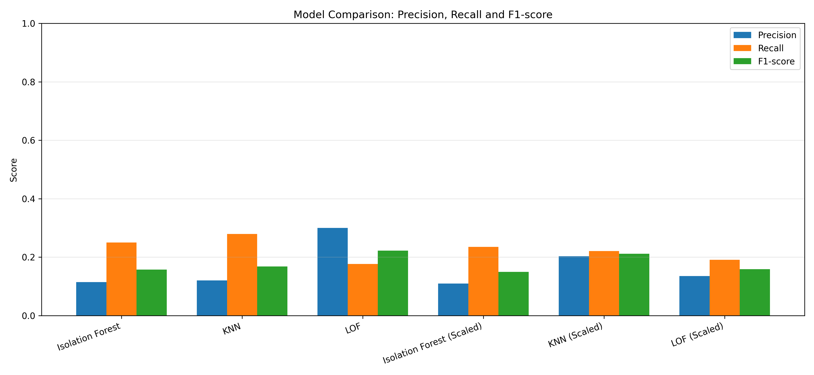
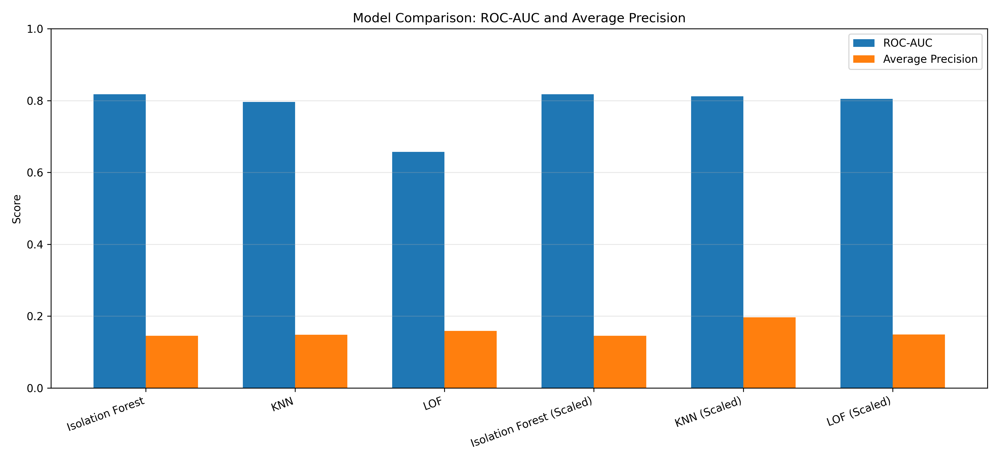
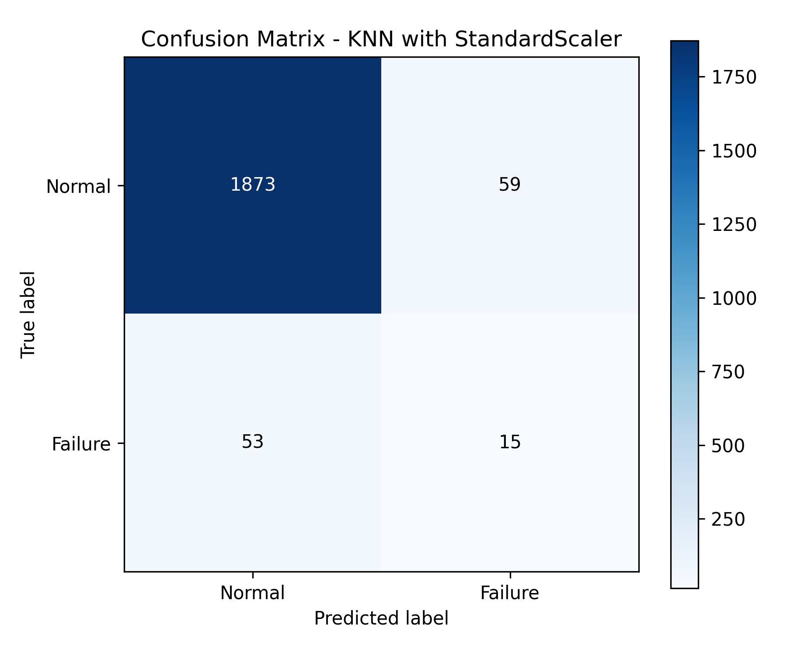

# Industrial AI Anomaly Detection

An experimental machine learning project exploring industrial anomaly detection using PyOD and the AI4I 2020 Predictive Maintenance Dataset.

## Project Overview

This project compares three unsupervised anomaly detection algorithms:

- Isolation Forest
- K-Nearest Neighbors (KNN)
- Local Outlier Factor (LOF)

It also explores threshold calibration and feature standardization.

**Note:** The dataset is synthetic. Results do not represent guaranteed performance in a real industrial environment.

## Dataset

AI4I 2020 Predictive Maintenance Dataset

- Source: https://archive.ics.uci.edu/dataset/601/ai4i+2020+predictive+maintenance+dataset
- DOI: https://doi.org/10.24432/C5HS5C
- License: CC BY 4.0
- 10,000 observations
- 14 columns
- 339 machine failures (3.39%)
- No missing values in the downloaded dataset

Selected sensor features:

- Air temperature [K]
- Process temperature [K]
- Rotational speed [rpm]
- Torque [Nm]
- Tool wear [min]

Target: Machine failure.

The models are fitted using sensor features only. Target labels are used for evaluation and validation threshold selection.

The raw dataset is excluded from Git. Download it from UCI and place `ai4i2020.csv` in `data/raw/`.

## Technology Stack

- Python 3.10
- PyOD 3.6.8
- Pandas 2.3.3
- NumPy 2.2.6
- Scikit-learn 1.7.2
- SciPy 1.15.3
- Matplotlib 3.10.9
- Pytest 9.2.0

## Project Structure

- `src/`: data audit, training, model comparison and plotting scripts.
- `data/raw/`: downloaded dataset (not tracked by Git).
- `results/`: metrics, audit reports and experiment results.
- `results/plots/`: generated visualizations.
- `tests/`: automated tests.
- `requirements.txt`: project dependencies.

## Installation

1. Create a virtual environment with `python3 -m venv .venv`.
2. Activate it with `source .venv/bin/activate`.
3. Install dependencies with `python -m pip install -r requirements.txt`.
4. Download the UCI dataset and place `ai4i2020.csv` in `data/raw/ai4i2020.csv`.

## Run the Experiments

From the project root:

- `python src/data_audit.py`
- `python src/train.py`
- `python src/compare_thresholds.py`
- `python src/compare_models.py`
- `python src/compare_models_scaled.py`
- `python src/generate_plots.py`

## Experimental Results

The model comparison uses stratified training, validation and test splits (60%, 20%, 20%).

Validation labels are used to select thresholds by maximizing F1-score. The test set is kept separate for final evaluation.

### Without StandardScaler

| Model | Precision | Recall | F1-score | ROC-AUC | Average Precision |
|---|---:|---:|---:|---:|---:|
| Isolation Forest | 0.1149 | 0.2500 | 0.1574 | 0.8176 | 0.1456 |
| KNN | 0.1203 | 0.2794 | 0.1681 | 0.7959 | 0.1484 |
| LOF | 0.3000 | 0.1765 | 0.2222 | 0.6571 | 0.1591 |

### With StandardScaler

| Model | Precision | Recall | F1-score | ROC-AUC | Average Precision |
|---|---:|---:|---:|---:|---:|
| Isolation Forest | 0.1096 | 0.2353 | 0.1495 | 0.8175 | 0.1455 |
| KNN | 0.2027 | 0.2206 | 0.2113 | 0.8121 | 0.1968 |
| LOF | 0.1354 | 0.1912 | 0.1585 | 0.8050 | 0.1486 |

### Key Findings

- Isolation Forest achieved the highest ROC-AUC without scaling.
- KNN benefited from StandardScaler, improving precision and Average Precision.
- LOF without scaling achieved the highest F1-score.
- No model performed best on every metric.

## Visualizations

### Precision, Recall and F1-score

### ROC-AUC and Average Precision

### KNN with StandardScaler: Confusion Matrix

Confusion matrix:

| | Predicted Normal | Predicted Failure |
|---|---:|---:|
| Actual Normal | 1873 | 59 |
| Actual Failure | 53 | 15 |

## Tests

Run automated tests using `python -m pytest tests/ -v`.

The current smoke test verifies that Isolation Forest trains and detects synthetic anomalies.

## Limitations

- The dataset is synthetic.
- The failure class is highly imbalanced.
- Only five sensor features are used.
- Threshold calibration uses labeled validation data.
- Real-world industrial validation is required before operational deployment.

## Future Improvements

- Evaluation on real industrial datasets.
- Time-series anomaly detection.
- Model explainability.
- Additional algorithms and hyperparameter optimization.
- Industrial monitoring dashboard.

## Author

Personal portfolio project focused on Industrial AI and Predictive Maintenance.
EOFcd ~/projects/industrial-ai-anomaly-detection

cat > README.md <<'EOF'
# Industrial AI Anomaly Detection

An experimental machine learning project exploring industrial anomaly detection using PyOD and the AI4I 2020 Predictive Maintenance Dataset.

## Project Overview

This project compares three unsupervised anomaly detection algorithms:

- Isolation Forest
- K-Nearest Neighbors (KNN)
- Local Outlier Factor (LOF)

It also explores threshold calibration and feature standardization.

**Note:** The dataset is synthetic. Results do not represent guaranteed performance in a real industrial environment.

## Dataset

AI4I 2020 Predictive Maintenance Dataset

- Source: https://archive.ics.uci.edu/dataset/601/ai4i+2020+predictive+maintenance+dataset
- DOI: https://doi.org/10.24432/C5HS5C
- License: CC BY 4.0
- 10,000 observations
- 14 columns
- 339 machine failures (3.39%)
- No missing values in the downloaded dataset

Selected sensor features:

- Air temperature [K]
- Process temperature [K]
- Rotational speed [rpm]
- Torque [Nm]
- Tool wear [min]

Target: Machine failure.

The models are fitted using sensor features only. Target labels are used for evaluation and validation threshold selection.

The raw dataset is excluded from Git. Download it from UCI and place `ai4i2020.csv` in `data/raw/`.

## Technology Stack

- Python 3.10
- PyOD 3.6.8
- Pandas 2.3.3
- NumPy 2.2.6
- Scikit-learn 1.7.2
- SciPy 1.15.3
- Matplotlib 3.10.9
- Pytest 9.2.0

## Project Structure

- `src/`: data audit, training, model comparison and plotting scripts.
- `data/raw/`: downloaded dataset (not tracked by Git).
- `results/`: metrics, audit reports and experiment results.
- `results/plots/`: generated visualizations.
- `tests/`: automated tests.
- `requirements.txt`: project dependencies.

## Installation

1. Create a virtual environment with `python3 -m venv .venv`.
2. Activate it with `source .venv/bin/activate`.
3. Install dependencies with `python -m pip install -r requirements.txt`.
4. Download the UCI dataset and place `ai4i2020.csv` in `data/raw/ai4i2020.csv`.

## Run the Experiments

From the project root:

- `python src/data_audit.py`
- `python src/train.py`
- `python src/compare_thresholds.py`
- `python src/compare_models.py`
- `python src/compare_models_scaled.py`
- `python src/generate_plots.py`

## Experimental Results

The model comparison uses stratified training, validation and test splits (60%, 20%, 20%).

Validation labels are used to select thresholds by maximizing F1-score. The test set is kept separate for final evaluation.

### Without StandardScaler

| Model | Precision | Recall | F1-score | ROC-AUC | Average Precision |
|---|---:|---:|---:|---:|---:|
| Isolation Forest | 0.1149 | 0.2500 | 0.1574 | 0.8176 | 0.1456 |
| KNN | 0.1203 | 0.2794 | 0.1681 | 0.7959 | 0.1484 |
| LOF | 0.3000 | 0.1765 | 0.2222 | 0.6571 | 0.1591 |

### With StandardScaler

| Model | Precision | Recall | F1-score | ROC-AUC | Average Precision |
|---|---:|---:|---:|---:|---:|
| Isolation Forest | 0.1096 | 0.2353 | 0.1495 | 0.8175 | 0.1455 |
| KNN | 0.2027 | 0.2206 | 0.2113 | 0.8121 | 0.1968 |
| LOF | 0.1354 | 0.1912 | 0.1585 | 0.8050 | 0.1486 |

### Key Findings

- Isolation Forest achieved the highest ROC-AUC without scaling.
- KNN benefited from StandardScaler, improving precision and Average Precision.
- LOF without scaling achieved the highest F1-score.
- No model performed best on every metric.

## Visualizations

### Precision, Recall and F1-score

### ROC-AUC and Average Precision

### KNN with StandardScaler: Confusion Matrix

Confusion matrix:

| | Predicted Normal | Predicted Failure |
|---|---:|---:|
| Actual Normal | 1873 | 59 |
| Actual Failure | 53 | 15 |

## Tests

Run automated tests using `python -m pytest tests/ -v`.

The current smoke test verifies that Isolation Forest trains and detects synthetic anomalies.

## Limitations

- The dataset is synthetic.
- The failure class is highly imbalanced.
- Only five sensor features are used.
- Threshold calibration uses labeled validation data.
- Real-world industrial validation is required before operational deployment.

## Future Improvements

- Evaluation on real industrial datasets.
- Time-series anomaly detection.
- Model explainability.
- Additional algorithms and hyperparameter optimization.
- Industrial monitoring dashboard.

## Author

Personal portfolio project focused on Industrial AI and Predictive Maintenance.
